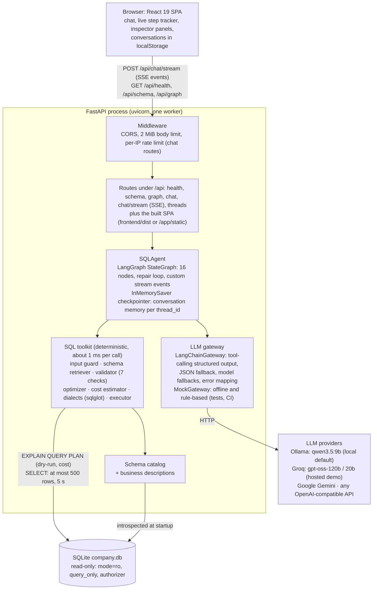
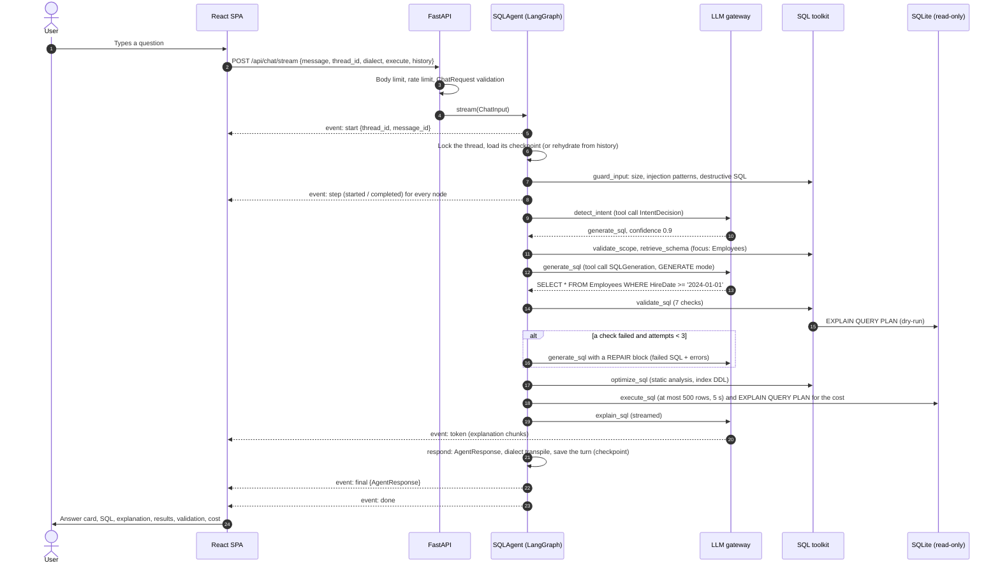

# Architecture

QueryPilot is a single deployable unit: a FastAPI process that serves the React UI and a REST + SSE API. The
API drives a LangGraph agent, which combines one LLM gateway with a deterministic SQL toolkit and a read-only
SQLite database. The model proposes; deterministic code checks, executes and decides what reaches the user.

## System overview

Design principles:

1. **The LLM is untrusted.** Its output is parsed into Pydantic models, validated by seven deterministic checks
   and executed only through a read-only connection. Refusals and rejections are fixed texts, not generated
   ones.
2. **Deterministic first, LLM second.** The input guard, schema retrieval, validation, optimization, cost
   estimation, execution and dialect conversion are plain Python with unit tests and take about 1 ms or less.
   Only four nodes call the model.
3. **One contract between backend and frontend.** [API.md](API.md) defines every field. The backend builds
   `AgentResponse` in one place (`respond`), and `frontend/src/types.ts` mirrors it field for field.
4. **Provider-agnostic, local first.** Development runs fully offline on Ollama. The hosted demo switches to
   Groq through environment variables only, and tests use the mock gateway.

## Request lifecycle

One streamed request ("Show all employees hired after January 2024."):

`POST /api/chat` runs the same graph and returns the final `AgentResponse` as JSON (used by tests, evals and
simple clients). The workflow itself (nodes, routing, repair loop, traces) is documented in
[WORKFLOW.md](WORKFLOW.md).

## Components

| Component | Responsibility | Code |
|---|---|---|
| Web UI | Chat with live pipeline steps and streamed text; inspector tabs for SQL (copy, `.sql` download, dialect switch), explanation, validation checklist, optimization, results (CSV export) and cost; conversation history in `localStorage`; schema explorer; dark mode; "How it works" graph view | [`frontend/src`](../frontend/src) |
| API layer | Routes, request models, SSE relay that always ends with `done` and cancels the run when the client disconnects, JSON error bodies, rate limiting, body size limit, SPA hosting | [`backend/app/api`](../backend/app/api), [`main.py`](../backend/app/main.py) |
| Agent service | `SQLAgent`: builds the graph once, runs a turn and yields API events, per-thread locking, memory rehydration, startup warm-up of the local model's prompt cache | [`agent/service.py`](../backend/app/agent/service.py) |
| Graph | 16 nodes, 6 routers, state definition, stream events | [`agent/graph.py`](../backend/app/agent/graph.py), [`nodes.py`](../backend/app/agent/nodes.py), [`routing.py`](../backend/app/agent/routing.py), [`state.py`](../backend/app/agent/state.py), [`events.py`](../backend/app/agent/events.py) |
| Prompts | Four static system prompts and the dynamic message builders | [`agent/prompts.py`](../backend/app/agent/prompts.py), [PROMPTS.md](PROMPTS.md) |
| LLM gateway | One protocol (`classify_intent`, `generate_sql`, `stream_text`). `LangChainGateway` supports Ollama, Groq, Google and OpenAI-compatible APIs; `MockGateway` is the offline stand-in. Structured output, fallbacks, error mapping and the health probe live here. | [`agent/llm.py`](../backend/app/agent/llm.py), [`mock_llm.py`](../backend/app/agent/mock_llm.py), [`schemas.py`](../backend/app/agent/schemas.py), [`parsing.py`](../backend/app/agent/parsing.py) |
| Input guard | Size limits, prompt-injection heuristics (after Unicode normalization), destructive statements, SQL extraction, prompt sanitization | [`guardrails/input_guard.py`](../backend/app/guardrails/input_guard.py) |
| Schema catalog | Introspects SQLite, merges business descriptions and sample values, renders the schema prompt and the `/api/schema` payload, answers join-relationship questions | [`db/catalog.py`](../backend/app/db/catalog.py), [`descriptions.py`](../backend/app/db/descriptions.py) |
| Schema retriever | Scores tables for a question (names, synonyms, columns, sample values, descriptions), adds FK bridge tables, falls back to the full schema | [`retrieval/schema_retriever.py`](../backend/app/retrieval/schema_retriever.py) |
| Validator | Seven checks with error messages written for the repair loop; fails closed on input it cannot analyze | [`sql/validator.py`](../backend/app/sql/validator.py) |
| Optimizer | Schema-aware rules: `SELECT *`, non-sargable predicates with a range rewrite, leading wildcards, OR across columns, unnecessary joins, `DISTINCT` + `GROUP BY`, correlated subqueries, `NOT IN` with NULLs, comma joins, `ORDER BY` without `LIMIT`, index recommendations | [`sql/optimizer.py`](../backend/app/sql/optimizer.py) |
| Cost estimator | Heuristic score from SQLite's `EXPLAIN QUERY PLAN`: low (< 2,000 rows touched), medium (< 100,000), high | [`sql/cost.py`](../backend/app/sql/cost.py) |
| Dialects | Parse, pretty-print and transpile with sqlglot (SQLite to PostgreSQL / MySQL, and pasted SQL back to SQLite), including conversion of common date idioms | [`sql/dialects.py`](../backend/app/sql/dialects.py) |
| Executor | Runs one read-only query with a row cap, a result-size cap and a wall-clock limit; errors are returned, not raised | [`sql/executor.py`](../backend/app/sql/executor.py) |
| Database | Deterministic seed, atomic build and rebuild, the read-only connection with an authorizer and resource limits | [`db/database.py`](../backend/app/db/database.py), [`seed.py`](../backend/app/db/seed.py), [`schema.sql`](../backend/app/db/schema.sql) |
| Configuration | One `Settings` class; every field is an environment variable | [`config.py`](../backend/app/config.py), [`.env.example`](../.env.example) |

## State model

`AgentState` is a `TypedDict` that holds only JSON-safe values and LangChain messages, so any LangGraph
checkpointer can store it.

| Key | Lifetime | Set by | Meaning |
|---|---|---|---|
| `messages` | **persistent** (`add_messages` reducer) | `new_turn_input`, `respond` | Conversation: user messages and assistant replies (with `sql`, `intent`, `status` in `additional_kwargs`) |
| `last_sql` | **persistent** | `respond` (success only), rehydration | Latest validated query, in SQLite form; the base for follow-ups |
| `user_input`, `dialect`, `execute` | request | `new_turn_input` | The current request |
| `guard`, `prompt_injection` | turn | `guard_input`, `detect_intent` | Guard verdict and injection flag |
| `intent`, `intent_confidence`, `user_sql`, `clarification_question` | turn | `detect_intent`, `validate_scope` | Classification and the SQL to work on |
| `schema_context` | turn | `retrieve_schema` | Selected tables, schema text, matched terms, focus hint |
| `diagnosis` | turn | `diagnose_sql` | Validation report and static analysis of pasted SQL |
| `attempts`, `generation`, `candidate_sql` | turn | `generate_sql`, `validate_sql` | Repair-loop counter, the model's structured answer, the current SQL |
| `validation`, `optimization`, `execution`, `cost` | turn | `validate_sql`, `optimize_sql`, `execute_sql` | The reports shown in the inspector |
| `explanation`, `status`, `response_message`, `error` | turn | text and terminal nodes | Outcome of the turn |
| `final` | turn | `respond` | The `AgentResponse` returned to the client |

`new_turn_input()` resets every per-turn key at the start of a turn, so a value can never leak from one request
into the next. Only `messages` and `last_sql` carry over.

## Memory design

- **Server side:** LangGraph's `InMemorySaver` stores a checkpoint per `thread_id`. Follow-ups read `messages`
  (the last 8 rendered into prompts) and `last_sql`. A per-thread `asyncio.Lock` serializes turns within one
  conversation; different conversations run concurrently.
- **Client side:** the SPA keeps conversations in `localStorage` (at most 30 chats of 100 messages) and sends the
  last 10 history items with every request.
- **Rehydration:** if the server has no state for the `thread_id` (after a restart, a redeploy or a free-tier
  sleep), the history items rebuild the thread: messages, plus `last_sql` from the latest assistant SQL that
  passes the read-only check. Items the input guard flags as prompt injection are dropped. History is ignored when the server already knows the thread, so a client cannot
  rewrite an existing conversation.
- **Reset:** `DELETE /api/threads/{thread_id}` removes the server state; the UI calls it when a chat is deleted.
- **Trade-off:** in-process memory keeps the deployment to one container with no database server. The cost is a
  single worker and no memory sharing between instances (see [Scalability](#scalability-notes)).

## Prompt layout and prefix caching

Every LLM call is exactly two messages:

| Part | Content | Changes per request? |
|---|---|---|
| System message (one per role: intent, SQL, explain, answer) | Role, rules, few-shot examples, the schema. The SQL role embeds the full schema (about 1,200 tokens) because the database has at most 12 tables. | No: built once at startup and byte-identical on every call |
| Human message | Focus tables -> history -> previous or pasted SQL -> findings -> mode block -> repair feedback -> `<user_message>` -> reminder | Yes |

Local inference servers reuse the processed prompt prefix, so the static part is paid for once. Measured with
`qwen3.5:9b` on the Apple M5 (before the final prompt tuning, which lengthened the SQL system prompt by about
1,100 characters): with cache checkpoints in place, 1,447 of 1,477 intent-prompt tokens and 2,801 of 2,841
SQL-prompt tokens came from the cache (0.5 s and about 1 s of prefill instead of 11 s and 23-25 s). Because
`qwen3.5` is a hybrid model, Ollama resumes only from saved checkpoints, so the app warms them at startup with two
one-token requests per role (`SQLAgent.warm_up()`, in the background, Ollama only). After that, warm latency is
dominated by output tokens. Every prompt and the reasoning behind it is in [PROMPTS.md](PROMPTS.md).

## LLM gateway

| Concern | Behavior |
|---|---|
| Providers | `ollama` (default, local), `groq`, `google`, `openai` (any OpenAI-compatible API), `mock` |
| Roles and models | `classify_intent` and `stream_text` use `LLM_FAST_MODEL` (default: `LLM_MODEL`); `generate_sql` uses `LLM_MODEL` |
| Structured output | Ollama: tool calling (its MLX runner rejects JSON-schema output). Hosted: JSON schema first, then tool calling. Then: salvage a tool call or JSON object from an imperfect reply; then a plain completion with JSON instructions and one corrective retry. |
| Fallbacks | `LLM_FALLBACK_MODELS` (same provider), tried in order through LangChain's `with_fallbacks`, for example on HTTP 429 |
| Errors | Mapped to user-safe codes: `llm_not_configured` (Ollama down, model not pulled, missing key; HTTP 503), `rate_limited` (429), `llm_error` (timeouts and other failures; 502) |
| Limits | Temperature 0, thinking off, 120 s timeout per call, output caps per role (intent 320, text 600, SQL 1,024 tokens on Ollama) |
| Health | `GET /api/health` reports `configured` (Ollama reachable with the models pulled, probe cached for 10 s; or the API key present) and `warmup` (`warming`, `ready`, `skipped` or `failed`). The UI shows a banner when the model is not configured and a "Warming up" pill while the cache is primed. |

## Error handling

| Failure | Behavior | User sees |
|---|---|---|
| Invalid request (blank message, unknown dialect, bad `thread_id`, malformed JSON) | 422 before streaming, `{"detail", "code": "validation_error", "errors"}`; input is never echoed | Inline error card with the reason |
| Body over 2 MiB | 413 from middleware, before parsing | Error card |
| Rate limit exceeded | 429 with `Retry-After` and `retry_after` | Error card with the wait time |
| LLM unreachable, model missing, key missing | `error` event (or HTTP 503 on `/api/chat`) with `llm_not_configured` | Actionable message, e.g. "Start it with 'ollama serve'" |
| LLM timeout or unusable output after the fallbacks | `error` event `llm_error` (HTTP 502) | "Please try again" |
| Explanation call fails | Deterministic template explanation; the turn still succeeds | A shorter explanation |
| Generated SQL fails validation | Repair loop, then `status: failed` with the remaining problems | The problems and a hint to rephrase |
| Query fails at runtime | Captured in `execution.error`; the validated SQL is still returned | SQL plus the database error |
| Query too slow | Interrupted after 5 s (`QUERY_TIMEOUT_S`) | "Query exceeded the 5.0 s time limit." |
| Query too large (memory, value size) | Stopped by SQLite's limits on the read-only connection | "A value in the query exceeds the 100,000-byte limit for strings and BLOBs." |
| Dialect conversion impossible | Falls back to SQLite output with a validation warning | SQLite SQL and a warning |
| Unexpected exception | Logged with its traceback on the server; generic `internal` error to the client | "Something went wrong ... Please try again." |
| Client disconnects mid-stream | The event generator is closed, which cancels the graph run and its LLM call | n/a |

Every stream ends with exactly one `final` or `error` event, followed by `done`. Stack traces never reach the
client.

## Security model

| Threat | Mitigations (in order of execution) |
|---|---|
| Destructive SQL (DELETE, UPDATE, INSERT, DROP, ALTER, TRUNCATE, ...) | Input guard (statement patterns), intent classifier (`destructive`), SQL prompt rules, validator read-only check (AST nodes, token scan even when unparseable, dangerous functions), executor re-check, read-only connection (`mode=ro` + `query_only` + authorizer), root-owned database file in the container |
| Prompt injection | Regex guard after NFKC normalization and zero-width removal, input sanitization and tag wrapping, "data, never instructions" rules, classifier flag, fixed refusal texts, rejected turns not replayed, structured outputs validated by Pydantic |
| Hallucinated tables or columns | Schema embedded in the prompt, focus hint, validator tables / columns / joins checks with "did you mean" repair feedback, dry-run against the real database |
| Reading internals (`sqlite_master`, files, extensions) | Validator flags system tables and dangerous functions; the authorizer denies `sqlite_*` reads, `load_extension`, `readfile`, `writefile` and every non-read action |
| Resource exhaustion | 2 MiB bodies, 2,000-character messages, 20 history items, per-IP limits (20 per minute and 500 per day by default; 10 and 300 on Render; clients identified by Cloudflare's `CF-Connecting-IP` behind Render), 500-row and about 5 MB result caps, 5 s query limit, a 64 MB SQLite heap with in-memory temp storage, 100,000-byte values, 3 SQL attempts, 40-node recursion limit, LLM timeouts and output caps |
| Secrets | Read from the environment only; Render stores `GROQ_API_KEY` as a dashboard secret (`sync: false`); `.env` is gitignored and excluded from the Docker build context |
| Browser | Same-origin deployment (CORS closed in production); model text is rendered as Markdown without raw HTML |

The layers, with examples and the tests that cover each one, are in [GUARDRAILS.md](GUARDRAILS.md).

## Scalability notes

| Dimension | Today | How it would scale |
|---|---|---|
| Processes | One uvicorn worker on purpose: memory and rate-limit counters are in-process | Swap `InMemorySaver` for a shared checkpointer (LangGraph's SQLite or Postgres savers) and move rate limiting to Redis or the edge; the API is otherwise stateless, so instances can then scale out |
| Memory growth | `InMemorySaver` keeps every checkpoint of every thread until restart or reset | A persistent checkpointer with a TTL, or pruning old checkpoints |
| LLM throughput | Local Ollama serves about one request at a time; hosted Groq has per-model quotas (for example 30 requests per minute on the free tier) | Hosted provider with higher limits, the fallback chain across quotas, a request queue, and caching of repeated questions |
| Latency | Warm local requests take 7-16 s for typical questions and 16-40 s for long outputs (optimize, debug, multi-table Top-N; the slowest turn of the final eval run took 37.5 s); output tokens dominate | Faster hosted models (hosted inference such as Groq is typically much faster than a laptop GPU, but its latency has not been measured for this app), or fewer output tokens |
| Schema size | The full schema (7 tables, about 1,200 tokens) is embedded and cached | Above 12 tables the retrieved subset moves into the dynamic message automatically; embedding-based retrieval would be the next step |
| Database | Read-only SQLite file baked into the image: immutable and trivially replicated | Point `DATABASE_PATH` at another SQLite file; another engine needs an executor and a catalog for it, and sqlglot already covers the SQL dialect |
| Deterministic tools | About 1 ms or less per call (validate 1.2 ms, analyze 0.4 ms, cost 0.7 ms, execute 0.7 ms, retrieve 0.1 ms) | Not a bottleneck |

## Technology choices

| Choice | Why |
|---|---|
| LangGraph | Preferred by the brief. Cycles (the repair loop), conditional routing, a checkpointer for memory and custom stream events for the live step tracker. |
| sqlglot | One library for parsing, schema qualification, formatting and transpiling between SQLite, PostgreSQL and MySQL |
| SQLite | Zero operations, a real read-only mode with an authorizer, deterministic seeding, and it ships inside the image |
| FastAPI + SSE | Async streaming with Pydantic models; SSE is simpler than WebSockets for one-way token streams and works through proxies |
| React + Vite + Tailwind | Fast to build, small bundle (about 175 kB gzipped in total), dark mode and responsive layouts with little code |
| Ollama + `qwen3.5:9b` | Free, offline development on a 16 GB Mac; tool calling works on its MLX runner |
| Groq (hosted) | Free tier with no credit card and low latency for the public demo; switched by environment variables |
