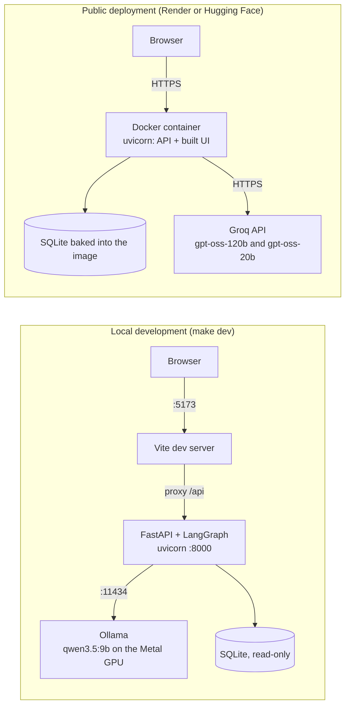

# Deployment and operations

QueryPilot runs in three ways, all free:

| Mode | LLM | Use it for |
|---|---|---|
| [Local development](#1-local-development-with-ollama) | Ollama with `qwen3.5:9b` on your Mac (offline, no API key) | building, QA, demos |
| [Local Docker](#2-local-docker) | Ollama on the host, or Groq | checking the production image |
| [Public deployment](#3-free-public-deployment-on-render) | Groq's free API | the live link for reviewers. Render is the primary host and [Hugging Face Spaces](#4-alternative-hugging-face-spaces) the alternative. |

The LLM provider and the model ids are environment variables, so moving between these modes (or replacing
a deprecated model) is a configuration change, not a code change.



---

## 1. Local development with Ollama

### Prerequisites

| Requirement | Notes | Install |
|---|---|---|
| macOS on Apple Silicon with 16 GB RAM | The model needs about 8 GB of memory and runs on the Metal GPU. | n/a |
| [uv](https://docs.astral.sh/uv/) | Creates the Python 3.12 environment (uv downloads Python 3.12 if needed). | `brew install uv` |
| Node.js 22.12 or newer | 22.22+ for the frontend unit tests. | `brew install node` |
| [Ollama](https://ollama.com) | Tested with 0.40.4. `make ollama` installs it with Homebrew if it is missing. | `brew install ollama` or the macOS app |
| About 8 GB of free disk | One-time download of `qwen3.5:9b` (7.6 GB). | n/a |
| `make`, `curl`, `lsof` | Preinstalled on macOS (`make` comes with the Xcode Command Line Tools). | `xcode-select --install` |

### First run

```bash
make setup    # backend/.venv (Python 3.12) and dependencies, frontend/node_modules, .env, sample database
make ollama   # start Ollama, pull qwen3.5:9b once, smoke-test it (idempotent: seconds on later runs)
make dev      # backend on :8000 and frontend on :5173; Ctrl+C stops both
```

Then open <http://localhost:5173>.

`make ollama` (`scripts/setup_ollama.sh`) skips every step that is already done, so it is safe to re-run. On a
machine where everything is in place it prints:

```text
 ok Ollama CLI found at /opt/homebrew/bin/ollama
 ok Ollama server 0.40.4 is running at http://localhost:11434
 ok Model qwen3.5:9b is already pulled
==> Smoke prompt to qwen3.5:9b (the first call after a restart loads the model into memory)...
 ok Model replied "OK" in 0.3 s (model load 0.0 s)
 ok Tool calling works (the app uses it for structured output)
 ok Ollama is ready. Next: make dev
```

The script reads `LLM_MODEL` (and `LLM_FAST_MODEL`, if it names a different model) from your environment or
`.env`. It never deletes or modifies models. Options: `--no-smoke` skips the smoke test, and a positional
`MODEL` argument prepares a different model.

`make dev` (`scripts/dev.sh`) checks the prerequisites before it starts anything. A missing `backend/.venv` or
`frontend/node_modules`, or a busy port, stops it with the fix to run. An Ollama server that is not running,
or a model that is not pulled, only produces a warning, so the UI still starts and shows the problem. Log
lines are prefixed with `[api]` or `[web]`.

### Make targets

Run `make` or `make help` to list them. Pass extra arguments to pytest or the eval runner with
`ARGS='...'`, for example `make test ARGS='-k validator'`.

| Target | What it does |
|---|---|
| `make setup` | Creates `backend/.venv` with uv (Python 3.12) if it is missing, installs `backend/requirements-dev.txt` and the frontend packages, copies `.env.example` to `.env` (never overwrites it), and builds the sample database. |
| `make ollama` | Installs and starts Ollama, pulls the model if it is missing, and runs a smoke prompt and a tool-calling check. |
| `make seed` | Rebuilds the deterministic sample database (`backend/data/company.db`). The app also builds it on first start if it is missing. |
| `make dev` | Runs the backend (auto-reload) on :8000 and the frontend (hot reload) on :5173 together. |
| `make backend` / `make frontend` | Runs one of the two dev servers on its own. |
| `make test` | Runs the backend tests (offline, `LLM_PROVIDER=mock`) and then the frontend unit tests (vitest). |
| `make test-live` | Runs the live integration tests in `backend/tests/integration` against the configured LLM (`RUN_LIVE_LLM=1`). |
| `make lint` | Runs ruff on the backend and the TypeScript type check on the frontend. |
| `make build` | Builds the production UI into `frontend/dist`. |
| `make serve` | Builds the UI, then serves the UI and the API from one process on <http://localhost:8000>, the same layout as the container. |
| `make evals` | Runs the golden-set evaluation against the configured LLM. |
| `make graph` | Exports the LangGraph workflow as Mermaid to `docs/graph.mmd` (uses the mock LLM, so no model is needed). |
| `make docker-build` / `make docker-run` | Builds or runs the production image ([section 2](#2-local-docker)). |
| `make clean` | Removes `frontend/dist` and the Python caches. |

### Ports

| Port | Service | Started by |
|---|---|---|
| 5173 | Vite dev server: the UI with hot reload. It proxies `/api` to :8000 (override the target with `VITE_API_TARGET`). | `make dev`, `make frontend` |
| 8000 | FastAPI backend (interactive API docs at `/api/docs`). With `make serve` or Docker it also serves the built UI. | `make dev`, `make backend`, `make serve`, Docker |
| 11434 | Ollama | Homebrew service, the Ollama app, or `ollama serve` |

### Configuration

`make setup` copies [`.env.example`](../.env.example) to `.env`. The backend reads `.env` from the repository
root (and `backend/.env`, which wins over it). Variables set in your shell win over both, which is handy for
one-off runs:

```bash
LLM_PROVIDER=mock make dev     # offline, rule-based answers: no model and no key needed
LOG_LEVEL=DEBUG make backend   # verbose agent logs
```

To use a hosted model locally, comment out the Ollama block in `.env` and uncomment the Groq, Google or
OpenAI-compatible block. All settings are listed in the [environment variable reference](#5-environment-variable-reference).

### Local performance

- **One model for every role.** `qwen3.5:9b` handles intent detection, SQL generation and explanations, so a
  16 GB machine never swaps models in and out of memory.
- **Thinking is off** (`LLM_REASONING=false`) for latency.
- **The model stays loaded** for `OLLAMA_KEEP_ALIVE` (30 minutes) after the last request. After that, or
  after a restart, the next request first loads 7.6 GB into memory. Run `make ollama` to warm it up before
  a demo.
- **Prompt prefix caching.** Each role's system prompt (rules, examples and the full schema) is
  byte-identical on every request, and per-request content comes last. Ollama therefore reuses the
  processed prefix: on this machine a 1,000-token prompt took 7.3 s cold and 1.5 s warm. The first
  question after a restart is the slowest one.

---

## 2. Local Docker

Docker is not needed for development. Render, Hugging Face and CI all build the same `Dockerfile`, which has
two stages:

1. `node:22-alpine` installs the frontend with `npm ci` and builds it.
2. `python:3.12-slim` installs `backend/requirements.txt`, copies `backend/app`, `backend/scripts` and
   `backend/evals`, bakes the sample database into `/app/data/company.db`, and copies the built UI to
   `/app/static`.

Both stages install exact versions: the frontend from `frontend/package-lock.json`, the backend from
`backend/constraints.txt` (the versions the test suite passed with; `make setup` and CI use it too), so a
rebuild weeks later installs the same packages. Every dependency ships prebuilt for linux/amd64 (Python
wheels, and npm binaries for both musl and glibc, recorded in the lockfile), so neither stage needs a
compiler. After changing `backend/requirements*.txt`, regenerate `backend/constraints.txt` with the
`uv pip compile` command in its header and run the tests.

The container runs as an unprivileged user (uid 1000) that cannot modify the database. It starts a single
uvicorn worker on `$PORT` (default 8000) with `--proxy-headers`, and has a `HEALTHCHECK` on `/api/health`.
There is a single worker on purpose: conversation memory and rate-limit counters live in process memory.

### Run it with the model on your Mac

```bash
make docker-build           # docker build -t querypilot:latest .
make docker-run             # http://localhost:8000, configured from .env
# or, equivalently:
docker compose up --build   # needs Docker Compose 2.24+ (the .env file is optional)
```

The model keeps running on the host. Docker on macOS has no access to the Metal GPU, so inside a container
`qwen3.5:9b` would run on the CPU only and far too slowly. The container reaches the host's Ollama at
`http://host.docker.internal:11434`. Both `make docker-run` and `docker-compose.yml` set `OLLAMA_BASE_URL` to
that address, because the `localhost` URL in `.env` would point at the container itself. Override it with
`DOCKER_OLLAMA_BASE_URL` if Ollama runs elsewhere. On Linux, Ollama listens on 127.0.0.1 by default, which
the Docker bridge cannot reach: start it with `OLLAMA_HOST=0.0.0.0` there.

Both commands also pin `DATABASE_PATH`, `STATIC_DIR` and `PORT` to the image layout, so host paths in `.env`
cannot break the container.

### Run it with Groq or without any LLM

```bash
# Offline smoke test with the rule-based mock LLM (this is what CI does)
docker run --rm -p 8000:8000 -e LLM_PROVIDER=mock querypilot:latest

# Groq: export GROQ_API_KEY first; `-e GROQ_API_KEY` passes it on without putting it in your shell history
docker run --rm -p 8000:8000 -e LLM_PROVIDER=groq -e LLM_MODEL=openai/gpt-oss-120b \
  -e LLM_FAST_MODEL=openai/gpt-oss-20b -e LLM_FALLBACK_MODELS=qwen/qwen3.8-27b -e GROQ_API_KEY \
  querypilot:latest
```

Set `LLM_MODEL` whenever you change `LLM_PROVIDER`. Its default (`qwen3.5:9b`) is an Ollama model name.

---

## 3. Free public deployment on Render

Free hosts offer between 512 MB and 16 GB of RAM and no GPU, which is far too little to serve a 9B model at a
usable speed. The public deployment therefore uses Groq's free API, which needs no credit card, and Render's
free Docker web service, which also needs no card. [`render.yaml`](../render.yaml) is a Render Blueprint
that describes the whole service.

Expect about 30 minutes for the first deployment.

### Step 1: get a free Groq API key (2 minutes)

1. Sign in at <https://console.groq.com>.
2. Open **API Keys**, choose **Create API Key**, and copy the key. Groq shows it only once.
3. Optional: check it locally first. In `.env`, comment out the Ollama block, uncomment the Groq block,
   paste the key into `GROQ_API_KEY=`, and run `make dev`.

The free tier limits each model separately. For `openai/gpt-oss-120b` the limits at the time of writing
(October 2026) are 30 requests per minute, 1,000 per day, 8,000 tokens per minute and 200,000 tokens per
day. See <https://console.groq.com/docs/rate-limits> for current values. A typical question makes three model
calls (intent detection, SQL generation and the explanation), plus one for each repair attempt. The cheap
steps (intent detection, explanations) use `openai/gpt-oss-20b`, which has its own quota.
When a model returns HTTP 429, the gateway tries the models in `LLM_FALLBACK_MODELS` (`qwen/qwen3.8-27b`).
Groq lists that model as a *preview* model, which it may retire at short notice. If it disappears, only the
fallback stops working; replace it with a current model from <https://console.groq.com/docs/models>.

### Step 2: push the code to GitHub (5 minutes)

Create an empty **public** repository on GitHub, without a README or a license, so the first push has no
conflicts. Then, from the project root:

```bash
git init -b main
git add -A
git status --short          # must NOT list .env, *.db, node_modules/, .venv/ or the assignment PDF
git commit -m "QueryPilot: SQL Query AI Agent"
git remote add origin https://github.com/<you>/querypilot.git
git push -u origin main
```

`.gitignore` already excludes secrets (`.env`), the generated database, build output, local environments and
the assignment PDF. Every push runs [GitHub Actions](../.github/workflows/ci.yml) with three jobs:

- **backend:** ruff and pytest with the mock LLM;
- **frontend:** vitest and the production build;
- **docker:** builds the image, then smoke-tests the running container (health, UI, schema, and one chat
  request with the mock LLM).

The docker job also verifies the image itself, because Docker is not needed locally.

### Step 3: create the Blueprint on Render (10 minutes)

1. Sign up at <https://dashboard.render.com> with your GitHub account. The free plan needs no credit card.
2. Choose **New > Blueprint**, connect GitHub if Render asks, and select the repository.
3. Render reads `render.yaml` and shows one resource: the web service `querypilot` (Docker, Free).
4. Render asks for `GROQ_API_KEY`. The Blueprint marks it `sync: false`, so it lives only in Render and never
   in the repository. Paste the key.
5. Choose **Deploy Blueprint**. The first build takes about 5 to 10 minutes: it builds the UI, installs the
   Python dependencies and bakes the sample database into the image. Render injects `PORT`, and the
   container listens on it.
6. When the deploy shows **Live**, open the service URL, which looks like
   `https://querypilot-xxxx.onrender.com`.

### Step 4: verify (2 minutes)

```bash
curl -s https://<your-service>.onrender.com/api/health
```

The response should contain `"provider": "groq"`, `"configured": true` and `"tables": 7`. If `configured` is
`false`, the key is missing: set `GROQ_API_KEY` under **Environment**. Then try these prompts in the UI:

- "Show all employees hired after January 2024."
- "Show all customers.", then "Only those from California." (a follow-up that modifies the previous query)
- "Delete all orders." (refused: read-only)
- "Who won the last World Cup?" (refused: out of scope)

Finally, put the URL into the README.

### Configuration on Render

`render.yaml` sets the following variables. Everything else uses the defaults in the
[reference](#5-environment-variable-reference).

| Variable | Value | Why |
|---|---|---|
| `LLM_PROVIDER` | `groq` | Free hosted LLM |
| `LLM_MODEL` | `openai/gpt-oss-120b` | SQL generation, repair, optimization and debugging |
| `LLM_FAST_MODEL` | `openai/gpt-oss-20b` | Intent detection and explanations, on a separate quota |
| `LLM_FALLBACK_MODELS` | `qwen/qwen3.8-27b` | Used when a model is rate-limited (HTTP 429) |
| `GROQ_API_KEY` | entered in the dashboard | Secret (`sync: false`) |
| `RATE_LIMIT_PER_MINUTE` / `RATE_LIMIT_PER_DAY` | `10` / `300` | Per-client limits that protect the shared free quota |

`CORS_ORIGINS` needs no entry: the image defaults it to empty (same-origin only), because the UI is served
from the same origin as the API.

To change a value, open the service in the dashboard, go to **Environment**, edit the value, and save. Render
redeploys with the new value. A model deprecation needs only this change.

### Updates

Push to `main`. The Blueprint sets `autoDeployTrigger: checksPass`, so Render deploys a commit only after its
GitHub Actions checks pass, and a broken commit never replaces a working demo. To deploy immediately anyway,
choose **Manual Deploy > Deploy latest commit**.

### Cold starts and keep-warm

- **Sleep.** A free instance stops after 15 minutes without traffic. The next request waits up to about a
  minute while the instance starts again.
- **Lost memory.** Conversation memory lives in process memory, so it is lost when the instance sleeps or
  redeploys. The browser re-sends the recent turns of a conversation, and the server rebuilds it from them,
  so follow-up questions keep working.
- **Small instance.** A free instance has 512 MB of RAM and a fraction of a CPU. The app needs about 110 MB
  (measured with the Groq client loaded), because it imports only the LLM provider it uses and the heavy
  work happens at Groq.
- **Optional keep-warm, for the review window only.** Create a free account at <https://uptimerobot.com>.
  Choose **New monitor**, type **HTTP(s)**, URL `https://<your-service>.onrender.com/api/health`, interval
  5 minutes. The health endpoint never calls the LLM, so the pings use no Groq quota. Render gives each
  workspace 750 free instance hours per month. One service that stays awake all month uses about 744 of
  them, so pause the monitor after the review.

---

## 4. Alternative: Hugging Face Spaces

[Hugging Face Spaces](https://huggingface.co/spaces) runs the same Docker image for free. Its free
`cpu-basic` hardware (2 vCPU, 16 GB RAM) is much larger than Render's free instance. It also sleeps only
after a long idle period (48 hours at the time of writing) instead of 15 minutes. That makes it a good
choice if Render's cold starts get in the way.

The complete steps, with the `hf` CLI commands, are in
[`deploy/huggingface/README.md`](../deploy/huggingface/README.md). That file is also the Space card: its YAML
header (`sdk: docker`, `app_port: 8000`) tells Hugging Face how to run the image. In short:

1. Create a write token at <https://huggingface.co/settings/tokens> and run `hf auth login`.
2. Run `hf repos create <user>/querypilot --type space --sdk docker ...` with `GROQ_API_KEY` as a secret
   (`-s`) and the same variables as on Render (`-e`).
3. Upload `deploy/huggingface/README.md` as `README.md`, then the Dockerfile, `backend/` and `frontend/`
   with `hf upload`.
4. Wait for the build (`hf spaces wait <user>/querypilot`), then open
   `https://<user>-querypilot.hf.space/api/health`.

The image needs no changes for Spaces: it listens on port 8000 and runs as uid 1000, which is what Spaces
expects.

---

## 5. Environment variable reference

Every setting is an environment variable, and names are case-insensitive. Precedence, from highest to
lowest: the process environment, `backend/.env`, `.env` in the repository root, and the defaults below.
[`.env.example`](../.env.example) documents the same settings.

### LLM

| Variable | Default | Description |
|---|---|---|
| `LLM_PROVIDER` | `ollama` | `ollama` (local), `groq`, `google`, `openai` (any OpenAI-compatible API) or `mock` (offline and rule-based, used by tests and CI) |
| `LLM_MODEL` | `qwen3.5:9b` | Main model: SQL generation, repair, optimization and debugging. Set it whenever you change the provider. |
| `LLM_FAST_MODEL` | empty (uses `LLM_MODEL`) | Model for the cheap steps: intent detection, explanations and answers |
| `LLM_FALLBACK_MODELS` | empty | Comma-separated models from the same provider, tried in order when a call fails (for example on HTTP 429) |
| `LLM_TEMPERATURE` | `0` | Sampling temperature |
| `LLM_TIMEOUT_S` | `120` | Seconds before a single LLM call is abandoned |
| `LLM_REASONING` | `false` | Thinking mode. When off, Ollama skips thinking and Groq's gpt-oss models use low reasoning effort. |
| `LLM_NUM_CTX` | `8192` | Context window in tokens (Ollama only). Prompts include the whole schema, so keep it at 8192 or more. |
| `LLM_MAX_OUTPUT_TOKENS` | `1024` | Upper bound for output tokens per call |
| `OLLAMA_BASE_URL` | `http://localhost:11434` | Ollama server |
| `OLLAMA_KEEP_ALIVE` | `30m` | How long Ollama keeps the model loaded after a request |
| `LLM_WARMUP` | `true` | Prime the local model's prompt cache in the background at startup (Ollama only). `/api/health` reports `llm.warmup`, and the UI shows "Warming up…" until it is ready. |
| `GROQ_API_KEY` | empty | Secret. Required for `groq`. |
| `GOOGLE_API_KEY` | empty | Secret. Required for `google`. |
| `OPENAI_API_KEY` | empty | Secret for `openai`. Not needed for a local OpenAI-compatible server. |
| `OPENAI_BASE_URL` | empty (OpenAI) | Base URL of an OpenAI-compatible API, for example `https://openrouter.ai/api/v1` or `http://localhost:1234/v1` (LM Studio) |

### Database, agent and API

| Variable | Default | Description |
|---|---|---|
| `DATABASE_PATH` | empty: `backend/data/company.db`, or `/app/data/company.db` in the image | SQLite file. The app opens it read-only and builds the sample database on first start if the file is missing. |
| `MAX_RESULT_ROWS` | `500` | Most rows returned per query. The response says `truncated: true` when more exist. |
| `QUERY_TIMEOUT_S` | `5` | Time limit for executing one query |
| `MAX_SQL_ATTEMPTS` | `3` | Attempts per request: the first generation plus self-corrections after failed validation |
| `MAX_INPUT_CHARS` | `2000` | Longest accepted user message |
| `HISTORY_WINDOW` | `8` | Recent conversation turns given to the model for follow-up questions |
| `RATE_LIMIT_ENABLED` | `true` | Per-client rate limits on the chat endpoints |
| `RATE_LIMIT_PER_MINUTE` | `20` | Requests per client per minute (`10` on Render) |
| `RATE_LIMIT_PER_DAY` | `500` | Requests per client per day (`300` on Render) |
| `CORS_ORIGINS` | `http://localhost:5173,http://127.0.0.1:5173`, empty in the image | Comma-separated origins allowed to call the API from another origin. Empty means same-origin only. |
| `STATIC_DIR` | empty (auto-detect `frontend/dist`, else `/app/static`) | Directory of the built UI. `/app/static` in the image. |
| `LOG_LEVEL` | `INFO` | `DEBUG`, `INFO`, `WARNING` or `ERROR` |

### Container and tooling

| Variable | Default | Used by |
|---|---|---|
| `PORT` | `8000` | The container: the port uvicorn listens on. Render injects it. |
| `DOCKER_OLLAMA_BASE_URL` | `http://host.docker.internal:11434` | `docker compose` and `make docker-run`: where the container finds Ollama |
| `IMAGE` | `querypilot:latest` | `make docker-build` and `make docker-run` |
| `RUN_LIVE_LLM` | unset | Tests: `1` enables the live tests in `backend/tests/integration` (`make test-live`) |
| `VITE_API_TARGET` | `http://localhost:8000` | Vite dev server: where it proxies `/api` |
| `NO_COLOR` | unset | Scripts in `scripts/`: any value turns off colored output |

---

## 6. Troubleshooting

### Ollama is not running

**Symptoms:** the UI shows that the LLM is not configured, `/api/health` reports `"configured": false`, and
chat replies say *"The local model server (Ollama) is not running."* `make dev` also warns at startup.

**Fix:** run `make ollama`, or start Ollama yourself with `brew services start ollama`, the Ollama app, or
`ollama serve`. To check it, run `curl http://localhost:11434/api/version`. If Ollama runs on another host or
port, set `OLLAMA_BASE_URL`.

### The model is not pulled

**Symptoms:** `/api/health` reports `"configured": false` although Ollama is running, and chat replies say
*"Model 'qwen3.5:9b' is not available. Run 'ollama pull qwen3.5:9b'."*

**Fix:** run `make ollama`, which pulls the model named by `LLM_MODEL` (and `LLM_FAST_MODEL`). Run
`ollama list` to see the pulled models. The name in `LLM_MODEL` must match one of them exactly.

### The first response is slow

The first request after Ollama starts, or after the model sat idle for `OLLAMA_KEEP_ALIVE`, loads 7.6 GB into
memory. It then processes the schema-heavy system prompts from scratch (about 7 s per 1,000 tokens on an
Apple M5). Later requests reuse the cached prompt prefix and are several times faster.

- Run `make ollama` before a demo to load the model.
- Check that the model is loaded with `ollama ps`.
- Raise `OLLAMA_KEEP_ALIVE` (for example `2h`) to keep it loaded longer.
- On machines with less memory, `qwen3.5:4b` is smaller and faster (`LLM_MODEL=qwen3.5:4b`, then
  `make ollama`).

On Render, a slow first request is the free instance's cold start
([section 3](#cold-starts-and-keep-warm)).

### "structured output is unavailable" (Ollama's MLX runner)

Ollama runs `qwen3.5:9b` on its MLX engine on Apple Silicon, and that runner rejects JSON-schema and
JSON-mode output (`format`) with `{"error":"structured output is unavailable"}`. The app does not depend on
it: with Ollama it gets structured output through **tool calling**, which works on MLX, and falls back to
extracting JSON from plain text, with one corrective retry. `make ollama` checks that tool calling works for
your model.

You only see this error if your own code sends `format` to Ollama. If you switch to a model without tool
calling, the plain-JSON fallback still works, only a little slower.

### HTTP 429 or "Too many requests"

There are two different limits:

- **The app's per-client limit.** The response is HTTP 429 with `"code": "rate_limited"` and a `retry_after`
  hint, and the UI says *"Too many requests: the limit is N per minute."* Wait for the indicated time.
  Locally, you can raise `RATE_LIMIT_PER_MINUTE` and `RATE_LIMIT_PER_DAY` or set `RATE_LIMIT_ENABLED=false`.
- **The provider's quota.** Groq's free tier is limited per model. The gateway then tries the models in
  `LLM_FALLBACK_MODELS`. If they are exhausted too, the reply says *"The language model is rate-limited right
  now."* Wait for the minute or day window to reset, or add another model to `LLM_FALLBACK_MODELS`.

### Port already in use

`make dev` stops with *"port 8000 is already in use by PID ..."*, and Vite fails because it uses
`--strictPort` instead of silently moving to another port. Usually an old dev server is still running.

```bash
lsof -nP -iTCP:8000 -sTCP:LISTEN   # likewise for 5173
kill <PID>
```

### Other problems

| Symptom | Fix |
|---|---|
| `make dev`: "backend/.venv is missing" or "frontend/node_modules is missing" | `make setup` |
| Database errors after changing `schema.sql` or the seed code | `make seed`. The app also rebuilds an outdated database on startup. |
| The container cannot reach Ollama | Check that `curl http://localhost:11434/api/version` works on the host. On Linux, start Ollama with `OLLAMA_HOST=0.0.0.0`. Point the container elsewhere with `DOCKER_OLLAMA_BASE_URL`. |
| Docker Compose rejects the `env_file` entry of `docker-compose.yml` | Upgrade to Docker Compose 2.24 or newer, which supports the optional `.env` file (`required: false`). |
| Render: the build fails at `npm ci` | Commit `frontend/package-lock.json`. |
| Render: `/api/health` reports `"configured": false` | Set `GROQ_API_KEY` under **Environment**. |
| Render: a push did not deploy | The commit's GitHub checks have not passed yet (or failed): see the **Actions** tab. Choose **Manual Deploy** to deploy anyway. |
| Render: "Model ... is not available from groq" | Groq retired the model, or the id is misspelled. Pick a current one from <https://console.groq.com/docs/models> and update `LLM_MODEL`, `LLM_FAST_MODEL` or `LLM_FALLBACK_MODELS`. |
| Render: every chat fails with "Could not reach the groq API" | Check the service logs. Groq may be down (<https://groqstatus.com>), or outbound HTTPS is blocked. |
