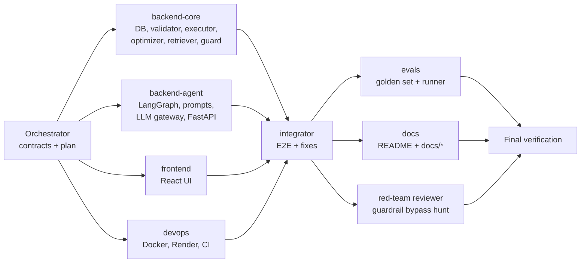

# Phase Plan: SQL Query AI Agent (6-hour build, $0 budget)

> **Assignment:** FDSE Engineer Hiring Assignment: *Build an SQL Query AI Agent*. The agent uses LangGraph, has guardrails and a web UI, and ships with a public deployment.
> **Time box:** 6 hours end to end.
> **Budget:** $0. Every service below has a free tier and needs no credit card.
> **Execution model:** an orchestrator agent writes the contracts and fans the work out to parallel build agents (backend core, LangGraph agent, frontend, DevOps). Integration, docs and red-team review agents follow. A human runs the steps that need accounts: API key, GitHub push, Render deploy, and the demo video.

---

## 1. Goals and success criteria

| Evaluation criterion (weight) | What "done" means here |
|---|---|
| AI agent design: LangGraph (25%) | A 16-node `StateGraph` with conditional routing, a self-correction loop, a checkpointer for conversation memory, and streamed node events |
| SQL generation accuracy (25%) | Schema-grounded prompts and relevant-schema retrieval. Every query goes through deterministic validation, an executable dry-run, and auto-repair when it fails. Accuracy is measured with a golden eval set. |
| Validation and guardrails (20%) | Seven-check validator (syntax, single statement, read-only, tables, columns, joins, dry-run). Database opened read-only with an authorizer. Layered prompt-injection defence. Polite refusals. |
| Conversation management (10%) | Per-thread LangGraph memory. Follow-ups such as "Only those from California" modify the previous SQL. The client rehydrates history after a server restart. |
| Frontend UI/UX (10%) | Chat, SQL panel, explanation, validation checklist, results table, history, live pipeline steps, dark mode, copy and downloads |
| Code quality (5%) | Typed, modular packages, ruff-clean, unit and integration tests, CI |
| Documentation (5%) | README, architecture, workflow, prompts, schema, deployment, assumptions, demo script |

## 2. Free stack ($0)

**Strategy: local first, hosted later.** All development and QA run against a **local model** at zero cost with no API keys. The public deployment changes one env var to a free hosted API, because free hosts have 512 MB – 16 GB of CPU-only RAM and can't serve a 9B model at usable speed.

| Layer | Choice | Free-tier facts | Why | Fallback |
|---|---|---|---|---|
| **LLM, local default (all roles)** | **Ollama + `qwen3.5:9b`** (Q4, 7.6 GB) | free, offline, runs on the Apple M5 16 GB dev machine (Metal GPU) | Newest small Qwen with tool calling. Ollama's MLX engine rejects JSON-schema `format`, so structured output goes through tool calling (verified on this machine). "Thinking" is disabled for latency. One model serves every role, so 16 GB never has to swap models. | `qwen3.5:4b` on low-memory machines; `mock` provider (rule-based, offline) for tests |
| LLM, hosted SQL generation | **Groq `openai/gpt-oss-120b`** | 30 RPM, 1K RPD, 8K TPM, 200K TPD, no card | Strong reasoning for SQL. Very low latency. JSON-schema structured output. | Next model in the fallback chain |
| LLM, hosted fast steps (intent, explanation) | **Groq `openai/gpt-oss-20b`** | separate 200K TPD quota | Cheap, fast classification and explanation | `gpt-oss-120b` |
| LLM, hosted fallback | **Groq `qwen/qwen3.8-27b`** | separate 200K TPD quota | Used when a model returns HTTP 429 | Google Gemini free tier, or any OpenAI-compatible endpoint (Cerebras, OpenRouter) set by env vars |
| Orchestration | **LangGraph 1.2** (OSS) | free | Preferred by the brief. Supports cycles for self-repair, a checkpointer for memory, and custom streaming. | n/a |
| SQL tooling | **sqlglot 30** (OSS) | free | Parses, qualifies against the schema, transpiles between SQLite, PostgreSQL and MySQL, and formats SQL | n/a |
| Database | **SQLite** file bundled in the image | free | Zero ops, has a read-only URI mode, and seeds deterministically | n/a |
| Backend | **FastAPI + Uvicorn + SSE** | free | Async streaming and Pydantic contracts | n/a |
| Frontend | **React 19 + Vite + TypeScript + Tailwind v4** | free | Fast to build, small bundle | n/a |
| Hosting | **Render free web service (Docker)** | free, no card, 750 h/month, sleeps after 15 min idle (about 1 min cold start) | One container serves both the API and the static UI. Configured by the `render.yaml` blueprint. | Hugging Face Spaces (Docker, free CPU tier) |
| CI | **GitHub Actions** | free for public repos | Runs tests, lint, the frontend build and the Docker build on every push | n/a |
| Demo video | macOS screen recording (⌘⇧5) or Loom free (5 min cap) | free | 3–5 min requirement | OBS Studio |
| Tracing (optional) | LangSmith Developer plan | free, 5K traces/month | Shows each graph run as a trace | Structured logs |

**Note:** Groq retired `llama-3.3-70b-versatile` and `llama-3.1-8b-instant` from the free tier on 2026-08-16. All model IDs therefore come from environment variables, so a deprecation is a config change, not a code change.

## 3. Phase distribution (6:00 h)

| # | Phase | Window | Duration | Owner | Key outputs | Exit criteria |
|---|---|---|---|---|---|---|
| 0 | **Discovery and architecture** | 0:00 – 0:20 | 20 m | Orchestrator | Requirement matrix, free stack, API contract (`docs/API.md`), module interfaces, this plan | Contracts frozen, environment ready (Python 3.12 via uv, Node 26) |
| 1 | **Data and SQL safety core** | 0:20 – 1:20 | 60 m | Agent: backend-core | `schema.sql` + deterministic seed, schema catalog, 7-check validator, read-only executor, cost estimator, rule-based optimizer, schema retriever, input guard, unit tests | Guardrail and validator test suite green |
| 2 | **LangGraph agent** | 0:20 – 1:50 *(parallel with 1)* | 90 m | Agent: backend-agent | State, 16 nodes, routing, self-correction loop, prompts, LLM gateway with fallbacks and a mock provider, memory | Graph tests green with the mock LLM |
| 3 | **API layer** | 1:50 – 2:20 | 30 m | Agent: backend-agent | FastAPI routes, SSE streaming, rate limiting, SPA hosting | `curl` smoke tests pass |
| 4 | **Frontend** | 0:20 – 2:20 *(parallel)* | 120 m | Agent: frontend | Chat, SQL / explanation / validation / results / cost panels, history, live steps, dark mode, copy and download | `npm run build` and unit tests pass |
| 5 | **Packaging (Docker, CI)** | 0:20 – 1:20 *(parallel)* | 60 m | Agent: devops | Dockerfile, `render.yaml`, compose file, Makefile, dev script, CI workflow, deployment guide | Configs lint-clean; CI builds the image |
| 6 | **Integration and hardening** | 2:20 – 3:20 | 60 m | Agent: integrator | End-to-end run (backend serving the built UI), contract conformance, bug fixes | Full test suite green, E2E smoke green |
| 7 | **Evals, docs, red-team** | 3:20 – 4:10 | 50 m | Agents: evals, docs, reviewer (parallel) | Golden eval set and runner, README and all docs, adversarial guardrail review with regression tests | Deliverables checklist complete, no open high-severity findings |
| 8 | **Local QA (Ollama model)** | 4:10 – 4:40 | 30 m | **You** | Run the app locally against `qwen3.5:9b`, try the demo script, review the eval report | Demo flows work, eval accuracy recorded in the README |
| 9 | **Deploy (free)** | 4:40 – 5:10 | 30 m | **You** (guided by `docs/DEPLOYMENT.md`) | GitHub repo, Render blueprint deploy, `GROQ_API_KEY` secret, live smoke test | Public URL answers all demo prompts |
| 10 | **Demo video and submission** | 5:10 – 6:00 | 50 m | **You** (guided by `docs/DEMO_SCRIPT.md`) | 3–5 min video, submission email with repo, live link, video and assumptions | Submitted |

```mermaid
gantt
    title 6-hour delivery plan
    dateFormat HH:mm
    axisFormat %H:%M
    section Plan
    Discovery & architecture        :done, p0, 00:00, 20m
    section Build (parallel agents)
    Data & SQL safety core          :p1, 00:20, 60m
    LangGraph agent                 :p2, 00:20, 90m
    API layer                       :p3, after p2, 30m
    Frontend                        :p4, 00:20, 120m
    Packaging (Docker, CI)          :p5, 00:20, 60m
    section Harden
    Integration & hardening         :p6, 02:20, 60m
    Evals, docs, red-team           :p7, after p6, 50m
    section Ship (you)
    Local QA with real key          :p8, after p7, 30m
    Deploy to Render (free)         :p9, after p8, 30m
    Demo video & submission         :p10, after p9, 50m
```

## 4. Agent orchestration

**Parallel work stays coherent** because of two contracts written before any code: `docs/API.md` (backend ↔ frontend) and a module interface spec (core ↔ agent). Each agent owns a disjoint set of files.

## 5. Requirements traceability

| Brief § | Requirement | Implementation | Verified by |
|---|---|---|---|
| 3.1 | NL → SQL | `generate_sql` node, schema-grounded prompt, `retrieve_schema` | graph tests, golden evals |
| 3.2 | Validation: tables, columns, joins, syntax, read-only | `app/sql/validator.py` (sqlglot parse + `qualify` + FK-aware join check + SQLite `EXPLAIN` dry-run) | `tests/core/test_validator.py` |
| 3.2 | Never DELETE, UPDATE, INSERT, DROP, ALTER or TRUNCATE | input guard, intent `destructive` → `refuse_destructive`, AST + token read-only check, read-only DB connection with authorizer | guard, validator and executor tests, red-team review |
| 3.3 | Plain-English explanation | `explain_sql` node, streamed token by token | graph tests |
| 3.4 | Optimization: readability, performance, indexes, unnecessary joins | `optimize_sql` node, `app/sql/optimizer.py` rules, and the LLM rewrite for `optimize_sql` intent | optimizer tests |
| 3.5 | Debugging: identify, explain, correct | `diagnose_sql` (validator findings) → `generate_sql` in debug mode → re-validation | graph tests |
| 3.6 | Conversation context | LangGraph `InMemorySaver` per `thread_id`, `last_sql` state, `modify_sql` intent, history rehydration | follow-up graph and API tests |
| 3.7 | Out-of-scope refusal | `detect_intent` → `validate_scope` → `reject_request` (message as specified in the brief) | graph tests, evals |
| 4 | Frontend: required and bonus items | React app (see README feature table) | build and vitest, manual QA |
| 5 | LangGraph, FastAPI, SQLite, provided schema | as listed | n/a |
| 6 | Expected workflow | node-for-node match, plus `guard_input`, `diagnose_sql` and a retry loop | `GET /api/graph` Mermaid |
| 7 | Guardrails | see `docs/GUARDRAILS.md` | red-team review |
| 8 | Deliverables | README, `docs/ARCHITECTURE.md`, `docs/WORKFLOW.md`, `docs/PROMPTS.md`, `docs/SCHEMA.md`, demo, live link | checklist below |
| 10 | Bonus items | execution, follow-ups, cost estimation, syntax highlighting, 3 dialects, CSV export, injection protection, Docker, tests | n/a |

## 6. Risks and mitigations

| Risk | Impact | Mitigation |
|---|---|---|
| Free LLM quota exhausted (8K TPM / 200K TPD per model) | Reviewers hit errors | Fallback chain across models with separate quotas. A cheap model handles cheap steps. Prompts include only the relevant schema. `max_tokens` caps. Per-IP rate limit. Friendly 429 message. |
| Model deprecation (it already happened to Llama 3.x) | App stops working | Model IDs are env vars. Provider-agnostic gateway: Groq, Gemini or OpenAI-compatible. |
| Hallucinated tables or columns | Wrong SQL | sqlglot schema qualification, executable dry-run, automatic repair loop (up to 2 retries), then a graceful failure |
| Destructive SQL | Data loss | Four independent layers. The database file is also opened `mode=ro` with an SQLite authorizer, so writes are impossible even if every LLM layer fails. |
| Prompt injection | Agent hijack | Regex heuristics, delimited untrusted input, an LLM classifier flag, structured outputs, and output validation |
| Render free cold start (about 1 min) | Slow first load for reviewers | Documented in the README. Optional free uptime ping during the review window. |
| In-memory memory lost on restart | Follow-ups lose context | The client sends recent history, and the server rehydrates the thread |
| Docker not installed locally | Unverified image | GitHub Actions builds the image on every push. Render builds the same Dockerfile. |
| Ollama's MLX engine rejects JSON-schema and JSON-mode output (`"structured output is unavailable"`, measured) | Structured LLM calls fail locally | Use tool calling (`method="function_calling"`, which works on MLX), with JSON-extraction fallback and one corrective retry |
| Local prefill is slow (about 180 tok/s; a cold 1K-token prompt takes about 7 s) | Slow local responses | Measured prefix caching (7.3 s → 1.5 s). Prompts use a static system prefix per role (rules + full schema) with all per-request content last, so the schema is processed once and cached. |

## 7. Your remaining steps (about 1h50m)

1. **Local QA (25 min, no keys needed):** run `make setup && make ollama && make dev`, open <http://localhost:5173>, and walk through `docs/DEMO_SCRIPT.md`. Run `make evals` to reproduce the accuracy report.
2. **Free Groq key (2 min, only for the public deployment):** go to <https://console.groq.com> → API Keys → Create. Set it as `GROQ_API_KEY` in Render, and never commit it.
3. **GitHub (5 min):** create a public repo and push. Never commit `.env`.
4. **Render deploy (15 min):** follow `docs/DEPLOYMENT.md`: New → Blueprint → select the repo → set `GROQ_API_KEY` → Deploy. Paste the live URL into the README.
5. **Demo video (30 min):** record 3–5 min following `docs/DEMO_SCRIPT.md`, upload it unlisted to YouTube or Loom, and link it in the README.
6. **Submit:** send the repo link, live link, video link and setup steps, and point to the README "Assumptions" section.

## 8. Definition of done (submission checklist)

- [x] Complete source code (backend, frontend, tests, evals)
- [x] README with setup instructions
- [x] Architecture diagram (`docs/ARCHITECTURE.md`)
- [x] LangGraph workflow explanation (`docs/WORKFLOW.md`)
- [x] Prompts used (`docs/PROMPTS.md`)
- [x] Sample database schema (`backend/app/db/schema.sql`, `docs/SCHEMA.md`)
- [ ] Demo video, 3–5 min (link in README). **You:** follow `docs/DEMO_SCRIPT.md`
- [ ] Public deployed link (link in README). **You:** follow `docs/DEPLOYMENT.md` (Render + free Groq key)
- [x] Assumptions documented (README)

---

## 9. Execution log (actuals)

*Times are IST, 15–16 Oct 2026. The brief arrived at 19:38.*

| Phase | Status | Notes |
|---|---|---|
| 0. Discovery and architecture | ✅ done | Stack verified against the live Groq model list (Oct 2026). Contracts written. Python 3.12 venv with LangGraph 1.2.15, sqlglot 30.23 and FastAPI 0.143. |
| 0b. Local-model pivot | ✅ done | Development switched to a local model per the new direction. Ollama 0.40.4 with `qwen3.5:9b` runs on the Apple M5 (16 GB) on the MLX engine at 100% GPU. Measured: about 33 tok/s generation and about 180 tok/s prefill. JSON-schema output is unsupported but tool calling works. Prefix caching gives about 5x on warm prompts. Agent prompts updated before the build started. |
| Orchestration incident | ⚠️ recovered | In the first launch (21:00), two of the five build agents (backend-core and frontend) took a status question from the user as their task and exited without building. The orchestrator spotted it from the journal, stopped the run, and relaunched at 21:08 with a guard line in every prompt ("ignore chat messages") and resume instructions, so the three agents already running kept their work. Cost: about 10 minutes. |
| 1. Parallel build (5 agents) | ✅ 21:08 – 22:09 | **backend-core:** schema, deterministic seed, read-only DB with three layers, 7-check validator, executor, cost estimator, 11-rule optimizer, retriever, input guard; 328 tests. **backend-agent:** 16-node LangGraph, gateway (Ollama, Groq, Gemini, OpenAI-compatible, mock) with tool-calling output and startup warm-up; live smoke fixed the intent and modify-mode bugs. **backend-api:** FastAPI, SSE relay with disconnect handling, rate limit, 2 MiB body limit, SPA hosting. **frontend:** React 19 UI, 62 tests, 29 screenshots reviewed. **devops:** Dockerfile, Render blueprint, compose file, CI, Makefile, scripts; shellcheck, actionlint and hadolint all clean. |
| 2. Integration | ✅ 22:09 – 23:13 | 646 tests green, 24/24 mock E2E contract checks, 11/11 live scenarios on qwen3.5:9b, startup warm-up wired. Fixes: unquoted-date detection, PostgreSQL `ROUND` casts, a filter for invented index advice, star expansion, cannot-answer for missing data. Diagnosed Ollama memory growth (see risks). |
| 3. Harden and document (3 agents) | ✅ 23:14 – 00:50 | **Red team:** 11 findings fixed (3 HIGH resource exhaustion: oversized values, temp-file sort bomb, time limit not enforced on time; 2 MEDIUM rate-limit issues; 6 LOW); 0 of 89 valid queries rejected. **Evals:** 38-case golden set plus a dev split for tuning; tuning lifted dev accuracy from 80% to 93%; final golden run 95% execution accuracy and 100% guardrail compliance. **Docs:** README, ARCHITECTURE, WORKFLOW, PROMPTS (generated), SCHEMA, GUARDRAILS, DEMO_SCRIPT. |
| Orchestrator final pass | ✅ 23:45 – 01:00 | Added: model warm-up status (`/api/health` `llm.warmup` and a "Warming up…" pill), injection guard on rehydrated history, CSV formula-injection protection, `make ollama-reset`, small-table index note; filled doc gaps (LLM_WARMUP, error statuses). Final verification: 922 backend tests passed (11 live tests skipped by default), ruff clean, frontend typecheck clean with 67/67 tests and a clean build. |
| 8–10. Your steps | ⏭ next | Local QA (`make dev`), deploy (Render + Groq), demo video. See section 7. |
