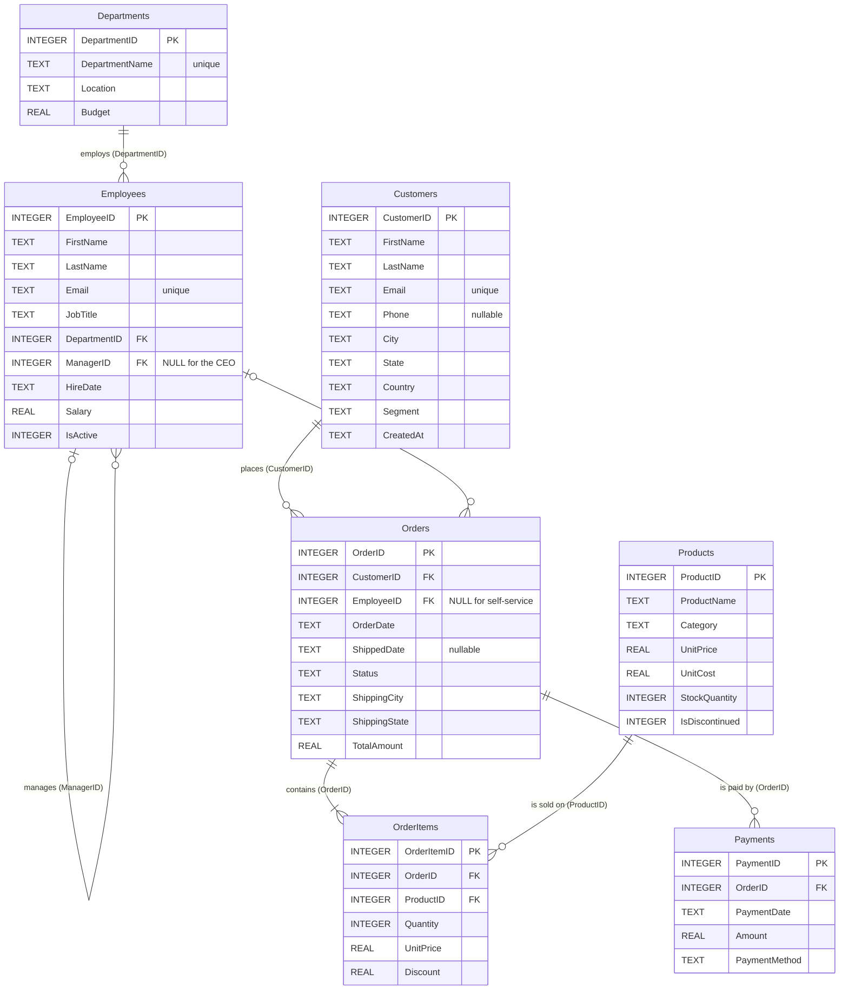

# Sample database schema

The brief did not include a schema, so QueryPilot ships its own: a small US retailer of office products
with **7 tables, 7 foreign keys and 9,527 rows**. The DDL is in
[`backend/app/db/schema.sql`](../backend/app/db/schema.sql). The descriptions shown to the model and in the
UI's schema explorer are in [`backend/app/db/descriptions.py`](../backend/app/db/descriptions.py).

| Property | Value |
|---|---|
| Engine | SQLite (the canonical execution dialect; output can be transpiled to PostgreSQL or MySQL) |
| File | `backend/data/company.db` (652 KiB, generated and gitignored; `/app/data/company.db` in the Docker image) |
| Build | Seeded deterministically by [`seed.py`](../backend/app/db/seed.py) with `random.Random(42)`; `make seed` rebuilds it, and the app builds it on first start |
| Rebuild trigger | `PRAGMA user_version` stores a hash of `schema.sql` + `seed.py`; a mismatch rebuilds the file atomically (`os.replace`) |
| Access | Always read-only: `mode=ro` URI, `PRAGMA query_only=ON` and an SQLite authorizer that allows reads only ([GUARDRAILS.md](GUARDRAILS.md#layer-6-read-only-database-connection)) |
| Conventions | PascalCase identifiers; dates are ISO-8601 `TEXT` (`'YYYY-MM-DD'`); money is `REAL` in USD; booleans are `INTEGER` 0/1; US states are full names (`'California'`, never `'CA'`) |

## Entity-relationship diagram

## Relationships

These seven foreign keys are the only joins the validator accepts as relationships (plus equality between
columns that identify the same key, such as `OrderItems.OrderID = Payments.OrderID`).

| From | To | Meaning |
|---|---|---|
| `Employees.DepartmentID` | `Departments.DepartmentID` | Department an employee works in |
| `Employees.ManagerID` | `Employees.EmployeeID` | Reporting line (self-reference; NULL for the CEO) |
| `Orders.CustomerID` | `Customers.CustomerID` | Customer who placed the order |
| `Orders.EmployeeID` | `Employees.EmployeeID` | Sales rep who handled the order (NULL for online self-service) |
| `OrderItems.OrderID` | `Orders.OrderID` | Line items of an order |
| `OrderItems.ProductID` | `Products.ProductID` | Product sold on a line |
| `Payments.OrderID` | `Orders.OrderID` | Payments for an order (installments allowed) |

## Tables

Row counts are from the generated database. Sample values are the ones the catalog extracts for low-cardinality
text columns; they appear in the model's schema prompt and in the schema explorer.

### Departments

Company departments with their office city and annual budget. **8 rows.**

| Column | Type | Key | Null | Description | Sample values |
|---|---|---|---|---|---|
| `DepartmentID` | INTEGER | PK | no | Unique department id. |  |
| `DepartmentName` | TEXT |  | no | Department name. | `Customer Support`, `Engineering`, `Finance`, `Human Resources`, `Marketing`, `Operations`, `Product`, `Sales` |
| `Location` | TEXT |  | no | Office city of the department. | `New York`, `San Francisco`, `Austin`, `Chicago`, `Denver`, `Seattle` |
| `Budget` | REAL |  | no | Annual budget in USD. |  |

Indexes: `idx_departments_name` (unique) on (DepartmentName)

### Employees

Company staff, including the sales reps assigned to orders; ManagerID gives the reporting line. **80 rows.**

| Column | Type | Key | Null | Description | Sample values |
|---|---|---|---|---|---|
| `EmployeeID` | INTEGER | PK | no | Unique employee id. |  |
| `FirstName` | TEXT |  | no | Employee first name. |  |
| `LastName` | TEXT |  | no | Employee last name. |  |
| `Email` | TEXT |  | no | Work email address. |  |
| `JobTitle` | TEXT |  | no | Job title, e.g. 'Software Engineer', 'Sales Representative', 'Account Executive'. |  |
| `DepartmentID` | INTEGER | FK -> Departments.DepartmentID | no | Department the employee works in. |  |
| `ManagerID` | INTEGER | FK -> Employees.EmployeeID | yes | EmployeeID of the direct manager; NULL for the CEO. |  |
| `HireDate` | TEXT |  | no | Hire date 'YYYY-MM-DD'. |  |
| `Salary` | REAL |  | no | Annual salary in USD. |  |
| `IsActive` | INTEGER |  | no | 1 = currently employed, 0 = former employee. |  |

Indexes: `idx_employees_department` on (DepartmentID), `idx_employees_email` (unique) on (Email)

### Customers

People and businesses that buy from the company (all in the USA). **300 rows.**

| Column | Type | Key | Null | Description | Sample values |
|---|---|---|---|---|---|
| `CustomerID` | INTEGER | PK | no | Unique customer id. |  |
| `FirstName` | TEXT |  | no | Customer (contact) first name. |  |
| `LastName` | TEXT |  | no | Customer (contact) last name. |  |
| `Email` | TEXT |  | no | Customer email address. |  |
| `Phone` | TEXT |  | yes | Phone number like '(415) 555-0142'; may be NULL. |  |
| `City` | TEXT |  | no | City name, e.g. 'Los Angeles'. |  |
| `State` | TEXT |  | no | Full US state name, never an abbreviation (e.g. 'California', not 'CA'). | `California`, `Texas`, `New York`, `Florida`, `Illinois`, `Washington`, ... (24 distinct) |
| `Country` | TEXT |  | no | Country; always 'USA'. | `USA` |
| `Segment` | TEXT |  | no | Customer segment: 'Consumer', 'Corporate' or 'Small Business'. | `Consumer`, `Corporate`, `Small Business` |
| `CreatedAt` | TEXT |  | no | Date the customer account was created, 'YYYY-MM-DD'. |  |

Indexes: `idx_customers_email` (unique) on (Email)

### Products

Product catalog with list price, unit cost and stock level. **60 rows.**

| Column | Type | Key | Null | Description | Sample values |
|---|---|---|---|---|---|
| `ProductID` | INTEGER | PK | no | Unique product id. |  |
| `ProductName` | TEXT |  | no | Product name. |  |
| `Category` | TEXT |  | no | One of 'Electronics', 'Furniture', 'Office Supplies', 'Software', 'Accessories'. | `Electronics`, `Office Supplies`, `Accessories`, `Furniture`, `Software` |
| `UnitPrice` | REAL |  | no | Current list price per unit in USD. |  |
| `UnitCost` | REAL |  | no | Cost per unit in USD (margin = UnitPrice - UnitCost). |  |
| `StockQuantity` | INTEGER |  | no | Units in stock; 0 = out of stock. |  |
| `IsDiscontinued` | INTEGER |  | no | 1 = no longer sold, 0 = active product. |  |

Indexes: none besides the primary key.

### Orders

One row per customer order: dates, status, shipping destination and order total. **2,000 rows.**

| Column | Type | Key | Null | Description | Sample values |
|---|---|---|---|---|---|
| `OrderID` | INTEGER | PK | no | Unique order id. |  |
| `CustomerID` | INTEGER | FK -> Customers.CustomerID | no | Customer who placed the order. |  |
| `EmployeeID` | INTEGER | FK -> Employees.EmployeeID | yes | Sales rep who handled the order; NULL for online self-service orders. |  |
| `OrderDate` | TEXT |  | no | Order date 'YYYY-MM-DD'. |  |
| `ShippedDate` | TEXT |  | yes | Ship date 'YYYY-MM-DD'; NULL while Pending or if Cancelled. |  |
| `Status` | TEXT |  | no | One of 'Pending', 'Shipped', 'Delivered', 'Cancelled', 'Returned'. | `Delivered`, `Cancelled`, `Returned`, `Shipped`, `Pending` |
| `ShippingCity` | TEXT |  | no | Destination city. |  |
| `ShippingState` | TEXT |  | no | Destination state, full US state name. | `California`, `Texas`, `Florida`, `New York`, `Massachusetts`, `Washington`, ... (24 distinct) |
| `TotalAmount` | REAL |  | no | Order total in USD = SUM(Quantity * UnitPrice * (1 - Discount)) of its items. |  |

Indexes: `idx_orders_customer` on (CustomerID), `idx_orders_date` on (OrderDate)

### OrderItems

Line items of each order: product, quantity, unit price and discount. **5,063 rows.**

| Column | Type | Key | Null | Description | Sample values |
|---|---|---|---|---|---|
| `OrderItemID` | INTEGER | PK | no | Unique line item id. |  |
| `OrderID` | INTEGER | FK -> Orders.OrderID | no | Order this line belongs to. |  |
| `ProductID` | INTEGER | FK -> Products.ProductID | no | Product sold on this line. |  |
| `Quantity` | INTEGER |  | no | Units sold. |  |
| `UnitPrice` | REAL |  | no | Price per unit in USD at the time of the order. |  |
| `Discount` | REAL |  | no | Discount fraction from 0 to 0.3 (0.1 = 10% off). |  |

Indexes: `idx_orderitems_order` on (OrderID), `idx_orderitems_product` on (ProductID)

### Payments

Payments received for orders; an order can be paid in several installments. **2,016 rows.**

| Column | Type | Key | Null | Description | Sample values |
|---|---|---|---|---|---|
| `PaymentID` | INTEGER | PK | no | Unique payment id. |  |
| `OrderID` | INTEGER | FK -> Orders.OrderID | no | Order being paid. |  |
| `PaymentDate` | TEXT |  | no | Payment date 'YYYY-MM-DD'. |  |
| `Amount` | REAL |  | no | Amount paid in USD. |  |
| `PaymentMethod` | TEXT |  | no | One of 'Credit Card', 'PayPal', 'Bank Transfer', 'Gift Card'. | `Credit Card`, `Bank Transfer`, `PayPal`, `Gift Card` |

Indexes: `idx_payments_order` on (OrderID)

## Indexes and constraints

| Index | Table (columns) | Purpose |
|---|---|---|
| `idx_departments_name` (unique) | Departments (DepartmentName) | Uniqueness |
| `idx_employees_email` (unique) | Employees (Email) | Uniqueness |
| `idx_customers_email` (unique) | Customers (Email) | Uniqueness |
| `idx_employees_department` | Employees (DepartmentID) | Foreign-key lookups |
| `idx_orders_customer` | Orders (CustomerID) | Foreign-key lookups |
| `idx_orders_date` | Orders (OrderDate) | Date-range filters |
| `idx_orderitems_order` | OrderItems (OrderID) | Foreign-key lookups |
| `idx_orderitems_product` | OrderItems (ProductID) | Foreign-key lookups |
| `idx_payments_order` | Payments (OrderID) | Foreign-key lookups |

`Customers.State`, `Employees.HireDate`, `Products.Category` and `Orders.Status` are **deliberately not
indexed**, so the optimizer has real index recommendations to make (for example
`CREATE INDEX idx_customers_state ON Customers (State);` after "Only those from California."). The optimizer only
recommends indexes for tables with at least 100 rows, so `Employees` (80 rows) never gets one.

`CHECK` constraints keep the data honest: enum values for `Segment`, `Category`, `Status` and `PaymentMethod`;
valid ISO dates; `ShippedDate >= OrderDate`; `Discount` between 0 and 0.3; positive prices, quantities and
amounts; `IsActive`/`IsDiscontinued` in (0, 1).

## Data profile

Facts that are handy for checking answers (all computed from the generated database):

| Fact | Value |
|---|---|
| Employees hired on or after 2024-01-01 (the brief's example) | 16 |
| Active employees | 74 of 80 |
| CEO (`ManagerID IS NULL`) | EmployeeID 1, Kenji Anderson |
| Employees per department | Engineering 20, Sales 16, Customer Support 10, Marketing 8, Product 8, Operations 7, Finance 6, Human Resources 5 |
| Customers in California (the brief's follow-up) | 45 (the most common of 24 states) |
| Customer segments | Consumer 171, Corporate 88, Small Business 41 |
| Customers without any order | 42 |
| Customers with a NULL phone | 11 |
| Orders date range | 2023-01-01 to 2026-09-29 (402 in 2023, 494 in 2024, 643 in 2025, 461 in 2026) |
| Order statuses | Delivered 1,775, Cancelled 124, Returned 77, Shipped 17, Pending 7 |
| Orders without a sales rep | 314 |
| Total order revenue (`SUM(TotalAmount)`) | 3,958,163.08 |
| Products per category | Electronics 14, Office Supplies 14, Accessories 12, Furniture 10, Software 10 |
| Discontinued / out-of-stock products | 5 / 3 |
| Payment methods | Credit Card 1,045, Bank Transfer 407, PayPal 393, Gift Card 171 |
| Quote-escaping test case | Last name `O'Brien` (4 people) |

The data is internally consistent: every order's `TotalAmount` equals the sum of its line items, cancelled
orders have no payments, and `PRAGMA foreign_key_check` passes after seeding.

## Example questions

| Question | What it exercises |
|---|---|
| Show all employees hired after January 2024. | Date filter (brief 3.1) |
| Show all customers. Then: Only those from California. | Follow-up that modifies the previous query (brief 3.6) |
| Average salary by department | Join + aggregate |
| Top 5 products by total revenue in 2025 | Three-table join through `OrderItems`, discounted revenue, date range, Top-N |
| Which customers have never placed an order? | Anti-join (`NOT EXISTS` / `LEFT JOIN ... IS NULL`) |
| List each employee with their manager's name | Self-join on `ManagerID` |
| Monthly revenue in 2025 | `strftime('%Y-%m', ...)` grouping with a sargable range filter |
| How many orders are in each status? | Grouping and counting |
| Payments by payment method | Grouping with money rounding |
| Products that are low in stock | Threshold filter, ordering |
| How are payments linked to orders? | Schema question answered in prose |
| Show supplier ratings for each product. | Data that does not exist: a clear "cannot answer" with the closest alternative |
